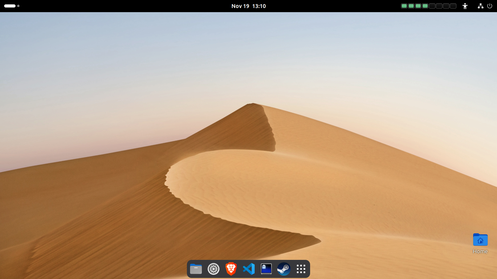

# Thirds — GNOME extension

Top-bar status item for GNOME Shell (targets GNOME 50). Renders the
current third of the day as 8 glass pills filling left to right — see
[`../docs/spec.md`](../docs/spec.md).

## Install (your session)

    ./install.sh

Enables the extension via dconf. On Wayland the running shell only
discovers new extensions at startup, so it appears **at your next
login** (no logout needed if you restart the session).

## Live test (no session disturbance)

    ./test-headless.sh [png-out]

Starts a private headless gnome-shell (GNOME 50's `--headless
--virtual-monitor`), lets the extension enable, unlocks, and captures
the stage through the extension's `THIRDS_DEBUG_SHOT` hook. Verified
result (12:39, day/green, 3 full + half):

## Unit tests (shared golden vectors)

    node --test test/*.test.mjs

## Placement

Left edge of the panel's right box: before the network/volume/power
indicators, i.e. as close to Ubuntu's centre clock as the right side
allows.

## Deviations from spec

- Appearance is hardcoded **dark**: Ubuntu's top panel is dark under
  both light and dark themes. (Android/macOS follow system light/dark.)
- The fill is a rounded capsule *inside* the glass pill rather than a
  square-cut flood; St CSS gives per-corner radii poorly, and the
  capsule reads more glass-like anyway.
